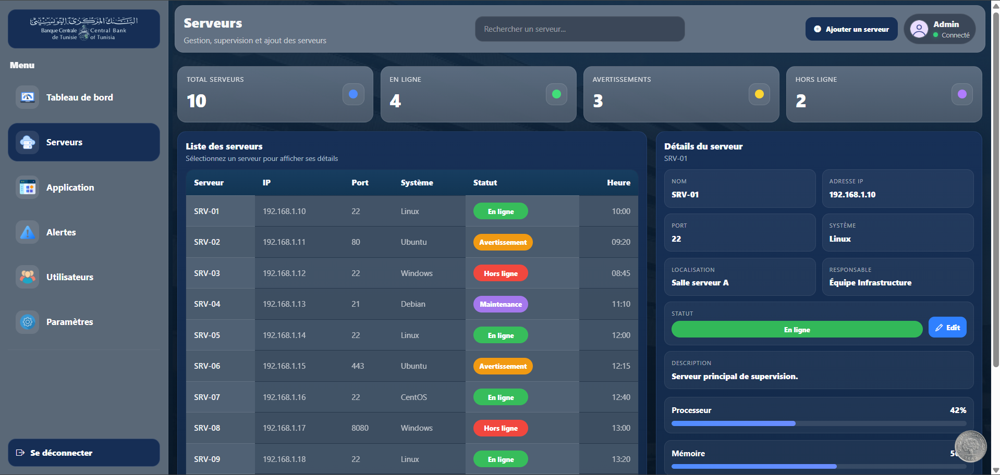
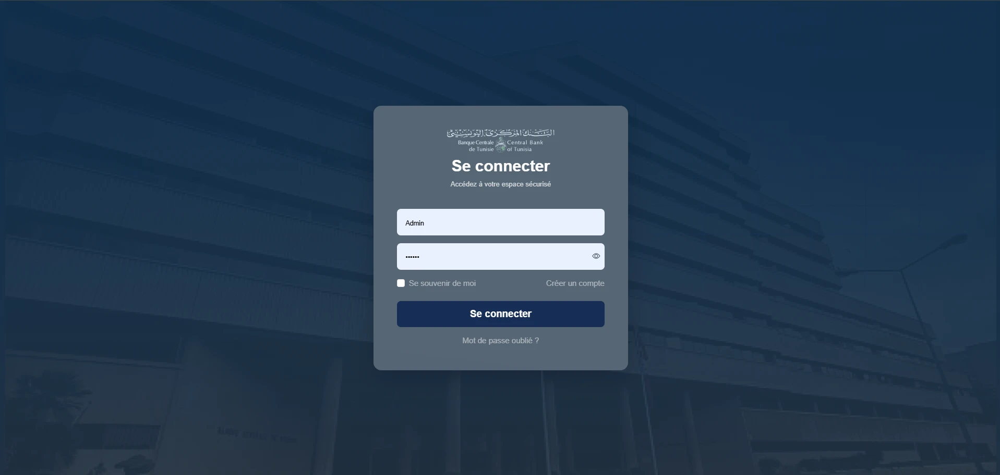
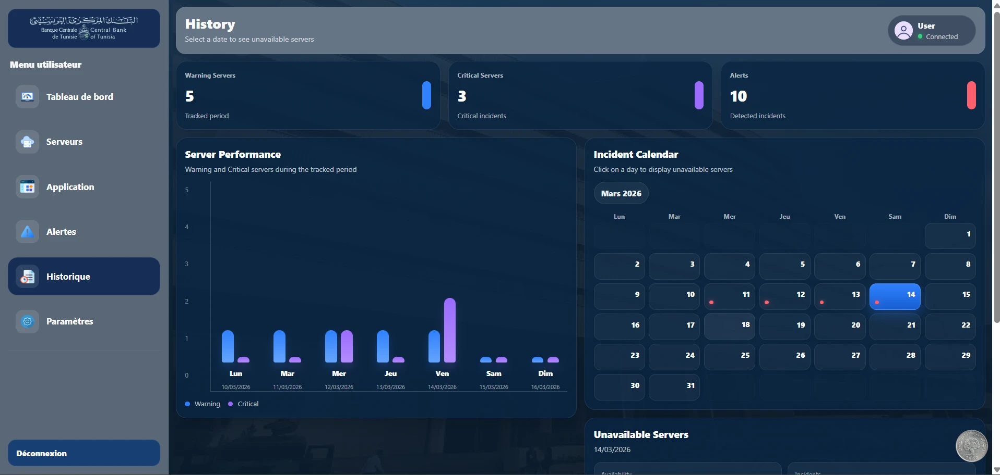
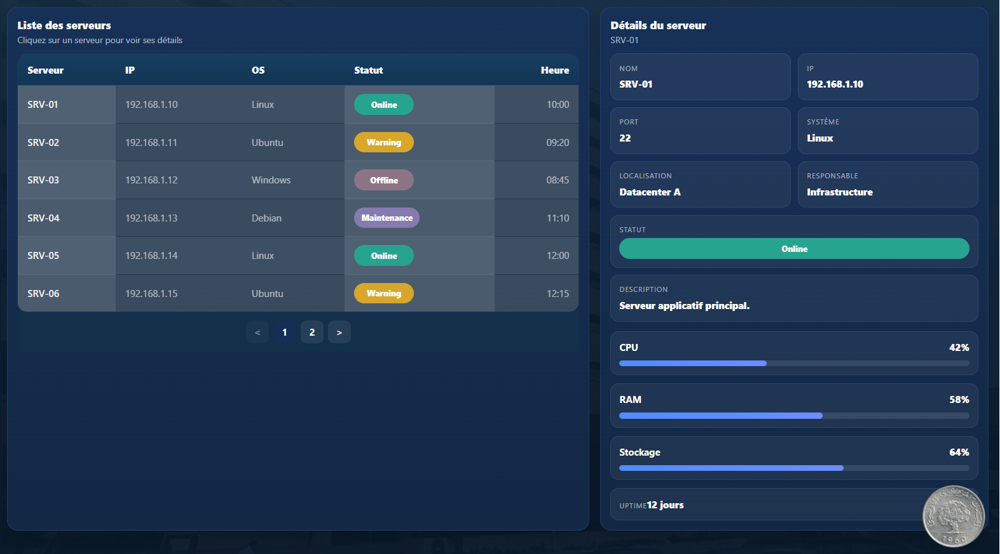
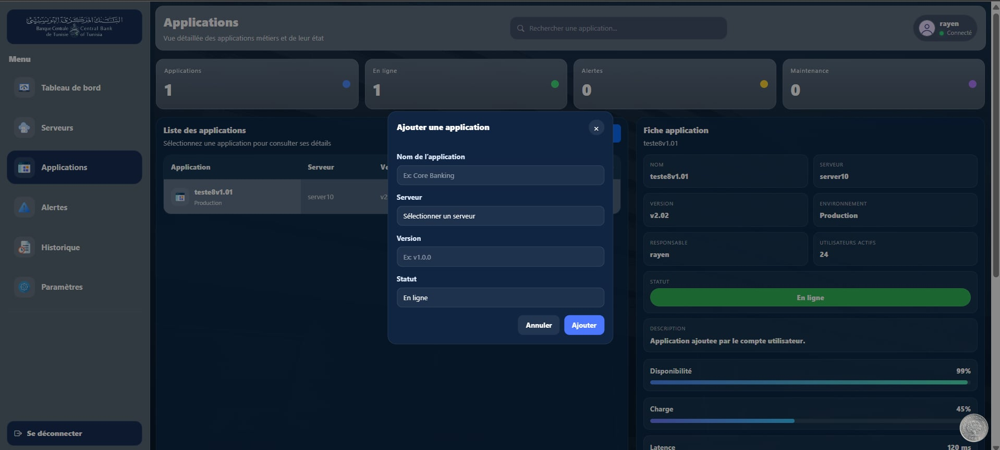

# Bank Supervision UI

Plateforme web de **supervision des serveurs et des applications** conçue et développée lors de mon stage de fin d'études (PFE) à la **Banque Centrale de Tunisie** (février → mai 2026).

> Design sur **Figma**, développement front-end en **Angular 21** et **TypeScript**.



---

## Le besoin

Les équipes techniques devaient surveiller des serveurs et des applications métiers, et repérer immédiatement les incidents critiques, sans se perdre dans des écrans chargés.

L'objectif : une interface où **l'information critique ressort en premier**, avec deux espaces adaptés à deux usages.

## Fonctionnalités

### Espace administrateur
- **Tableau de bord** : indicateurs clés (total, en ligne, avertissements, hors ligne)
- **Serveurs** : liste filtrable, fiche détaillée (IP, port, système, CPU, mémoire, stockage, uptime), ajout et édition
- **Applications** : suivi des applications métiers (disponibilité, charge, latence), ajout via modale
- **Alertes** : statuts lisibles en un coup d'œil (en ligne, avertissement, hors ligne, maintenance)
- **Utilisateurs** et **Paramètres**

### Espace utilisateur
- Tableau de bord, serveurs, applications et alertes en consultation
- **Historique** : calendrier des incidents cliquable et graphique des alertes par jour

### Commun
- Connexion et inscription
- **Chatbot** d'assistance intégré

## Captures d'écran

| Connexion | Historique |
|---|---|
|  |  |

| Détail serveur | Applications |
|---|---|
|  |  |

## Stack technique

- **Angular 21** (composants standalone, routing)
- **TypeScript 5.9**
- **RxJS** (services basés sur des `Observable`)
- HTML5, CSS3, design responsive
- **Figma** pour les maquettes et le design system

## Architecture

```
src/app/
├── pages/          # une page = un composant (admin et utilisateur)
│   ├── login/ register/
│   ├── admin-dashboard/ servers/ alerts/ application/ users/ settings/
│   ├── user-dashboard/ user-servers/ alert-user/ application-users/
│   ├── user-history/ users-settings/
│   └── chat-bot/
├── services/       # accès aux données
│   ├── server.service.ts
│   ├── application.service.ts
│   ├── alert.service.ts
│   ├── user.service.ts
│   └── auth.service.ts
├── shared/
│   └── chat-widget/
└── app.routes.ts   # routes admin / utilisateur
```

Les services exposent les données via des `Observable` (RxJS), ce qui permet de brancher une vraie API REST sans modifier les composants :

```ts
@Injectable({ providedIn: 'root' })
export class ServerService {
  getAllServers(): Observable<ServerItem[]> {
    return of(this.servers);
  }
}
```

> Les données affichées sont des **données de démonstration** (adresses IP privées, serveurs fictifs).

## Lancer le projet

```bash
git clone https://github.com/Sakhrouch/bank-supervision-ui.git
cd bank-supervision-ui
npm install
ng serve
```

Puis ouvrir `http://localhost:4200/`.

## Auteur

**Aymen Sakhri**, Designer UI/UX & développeur Angular

- Portfolio : [sakhrouch.github.io](https://sakhrouch.github.io)
- LinkedIn : [linkedin.com/in/aymen-sakhri-87070823b](https://www.linkedin.com/in/aymen-sakhri-87070823b)
- Behance : [behance.net/Aymensakhri](https://www.behance.net/Aymensakhri)

Projet réalisé en binôme dans le cadre du PFE, Licence en Communication Multimédia, ISAMM.
